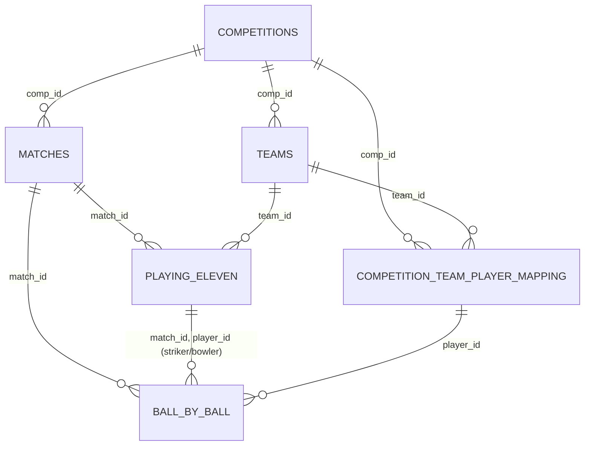

# 📋 DATA AUDIT REPORT — Official Rajasthan Royals 6:00 PM Data Pack
**Generated:** 2026-11-11 18:06:46
**Directory:** `C:\Users\munai\Downloads\superr-selector-2027\src\..\data\raw`
**Files Audited:** 6 core CSV tables + Round 1 Problem Statement PDF

---

## 1. Executive Summary Table of All 6 CSV Files

| File Name | File Size | Row Count | Column Count | Primary Key / Grain | Description |
|-----------|-----------|-----------|--------------|---------------------|-------------|
| `competitions.csv` | 0.01 MB | 141 | 4 | `comp_id` | Competition metadata (IPL, T20Is, Asia Cup) from 2022 to 2026 |
| `teams.csv` | 0.01 MB | 353 | 3 | `comp_id, team_id` | Teams registered per competition |
| `matches.csv` | 0.12 MB | 883 | 22 | `match_id` | Match-level records with dates, teams, venues, toss, and outcomes |
| `playing_eleven.csv` | 0.92 MB | 28,381 | 9 | `match_id, player_id` | Player team rosters, batting order, WK, Captain, Impact Sub |
| `competition_team_player_mapping.csv` | 0.44 MB | 6,413 | 6 | `comp_id, team_id, player_id` | Player registry across tournaments and franchises/nations |
| `ball_by_ball.csv` | 39.17 MB | 200,999 | 33 | `match_id, innings, overid, over_ball_num` | Delivery-level events: runs, wickets, extras, shot, line, speed |

---

## 2. Table-by-Table Schema Details & Sample Rows

### 2.1 `competitions.csv` (141 rows, 4 columns)

| # | Column Name | Data Type | Missing Count | Missing % | Sample Values |
|---|-------------|-----------|---------------|-----------|---------------|
| 1 | `comp_id` | `int64` | 0 | 0.00% | 3395, 3405, 3465 |
| 2 | `comp_name` | `object` | 0 | 0.00% | South Africa in New Zealand T20I Series , Afghanistan v Sri Lanka T20I Series 2026, India in Zimbabwe T20I Series 2026 |
| 3 | `match_format` | `object` | 0 | 0.00% | T20I, T20 |
| 4 | `season` | `object` | 0 | 0.00% | 2026, 2022, 2023 |

#### First 3 Sample Rows:

|   comp_id | comp_name                                    | match_format   |   season |
|----------:|:---------------------------------------------|:---------------|---------:|
|      3395 | South Africa in New Zealand T20I Series 2026 | T20I           |     2026 |
|      3405 | Afghanistan v Sri Lanka T20I Series 2026     | T20I           |     2026 |
|      3465 | India in Zimbabwe T20I Series 2026           | T20I           |     2026 |

---

### 2.2 `teams.csv` (353 rows, 3 columns)

| # | Column Name | Data Type | Missing Count | Missing % | Sample Values |
|---|-------------|-----------|---------------|-----------|---------------|
| 1 | `comp_id` | `int64` | 0 | 0.00% | 1331, 1335, 1345 |
| 2 | `team_id` | `int64` | 0 | 0.00% | 22, 28, 18 |
| 3 | `team_name` | `object` | 0 | 0.00% | England, West Indies, India |

#### First 3 Sample Rows:

|   comp_id |   team_id | team_name   |
|----------:|----------:|:------------|
|      1331 |        22 | England     |
|      1331 |        28 | West Indies |
|      1335 |        18 | India       |

---

### 2.3 `matches.csv` (883 rows, 22 columns)

| # | Column Name | Data Type | Missing Count | Missing % | Sample Values |
|---|-------------|-----------|---------------|-----------|---------------|
| 1 | `match_id` | `int64` | 0 | 0.00% | 13511, 13512, 13513 |
| 2 | `comp_id` | `int64` | 0 | 0.00% | 1331, 1335, 1345 |
| 3 | `match_number` | `int64` | 0 | 0.00% | 1, 2, 3 |
| 4 | `match_date` | `object` | 0 | 0.00% | 2022-01-22, 2022-01-23, 2022-01-26 |
| 5 | `stage` | `object` | 0 | 0.00% | League, Qualifier, Eliminator |
| 6 | `venue_id` | `int64` | 0 | 0.00% | 54, 8, 44 |
| 7 | `venue_country` | `object` | 0 | 0.00% | West Indies, India, Australia |
| 8 | `home_team_id` | `int64` | 0 | 0.00% | 28, 18, 20 |
| 9 | `home_team` | `object` | 0 | 0.00% | West Indies, India, Australia |
| 10 | `away_team_id` | `int64` | 0 | 0.00% | 22, 28, 27 |
| 11 | `away_team` | `object` | 0 | 0.00% | England, West Indies, Sri Lanka |
| 12 | `home_team_captain_id` | `float64` | 44 | 4.98% | 494.0, 126.0, 250.0 |
| 13 | `away_team_captain_id` | `float64` | 45 | 5.10% | 478.0, 1596.0, 494.0 |
| 14 | `toss_win_team_id` | `float64` | 15 | 1.70% | 28.0, 22.0, 18.0 |
| 15 | `toss_opted` | `object` | 15 | 1.70% | Fielding, Batting |
| 16 | `man_of_the_match` | `int64` | 0 | 0.00% | 0, 4986, 1699 |
| 17 | `first_inn_revised_overs` | `float64` | 858 | 97.17% | 114.0, 84.0, 66.0 |
| 18 | `second_inn_revised_overs` | `float64` | 858 | 97.17% | 114.0, 42.0, 48.0 |
| 19 | `revised_target` | `float64` | 860 | 97.40% | 143.0, 56.0, 91.0 |
| 20 | `knock_out` | `int64` | 0 | 0.00% | 0, 1 |
| 21 | `win_team_id` | `float64` | 41 | 4.64% | 28.0, 22.0, 18.0 |
| 22 | `result` | `object` | 0 | 0.00% | West Indies Won by 9 Wickets, England Won by 1 Run, West Indies Won by 20 runs |

#### First 3 Sample Rows:

|   match_id |   comp_id |   match_number | match_date   | stage   |   venue_id | venue_country   |   home_team_id | home_team   |   away_team_id | away_team   |   home_team_captain_id |   away_team_captain_id |   toss_win_team_id | toss_opted   |   man_of_the_match |   first_inn_revised_overs |   second_inn_revised_overs |   revised_target |   knock_out |   win_team_id | result                       |
|-----------:|----------:|---------------:|:-------------|:--------|-----------:|:----------------|---------------:|:------------|---------------:|:------------|-----------------------:|-----------------------:|-------------------:|:-------------|-------------------:|--------------------------:|---------------------------:|-----------------:|------------:|--------------:|:-----------------------------|
|      13511 |      1331 |              1 | 2022-01-22   | League  |         54 | West Indies     |             28 | West Indies |             22 | England     |                    nan |                    nan |                 28 | Fielding     |                  0 |                       nan |                        nan |              nan |           0 |            28 | West Indies Won by 9 Wickets |
|      13512 |      1331 |              2 | 2022-01-23   | League  |         54 | West Indies     |             28 | West Indies |             22 | England     |                    494 |                    478 |                 28 | Fielding     |                  0 |                       nan |                        nan |              nan |           0 |            22 | England Won by 1 Run         |
|      13513 |      1331 |              3 | 2022-01-26   | League  |         54 | West Indies     |             28 | West Indies |             22 | England     |                    494 |                   1596 |                 22 | Fielding     |               4986 |                       nan |                        nan |              nan |           0 |            28 | West Indies Won by 20 runs   |

---

### 2.4 `playing_eleven.csv` (28,381 rows, 9 columns)

| # | Column Name | Data Type | Missing Count | Missing % | Sample Values |
|---|-------------|-----------|---------------|-----------|---------------|
| 1 | `match_id` | `int64` | 0 | 0.00% | 13511, 13512, 13513 |
| 2 | `team_id` | `int64` | 0 | 0.00% | 22, 28, 18 |
| 3 | `player_id` | `int64` | 0 | 0.00% | 1187, 6273, 1210 |
| 4 | `batting_order` | `float64` | 8,678 | 30.58% | 1.0, 2.0, 3.0 |
| 5 | `is_played` | `bool` | 0 | 0.00% | True, False |
| 6 | `is_captain` | `object` | 8,667 | 30.54% | False, True |
| 7 | `is_wk` | `object` | 8,667 | 30.54% | False, True |
| 8 | `is_impact` | `int64` | 0 | 0.00% | 0, 1 |
| 9 | `is_impact_off` | `int64` | 0 | 0.00% | 0, 1 |

#### First 3 Sample Rows:

|   match_id |   team_id |   player_id |   batting_order | is_played   | is_captain   | is_wk   |   is_impact |   is_impact_off |
|-----------:|----------:|------------:|----------------:|:------------|:-------------|:--------|------------:|----------------:|
|      13511 |        22 |        1187 |               1 | True        | False        | False   |           0 |               0 |
|      13511 |        22 |        6273 |               2 | True        | False        | False   |           0 |               0 |
|      13511 |        22 |        1210 |               3 | True        | False        | False   |           0 |               0 |

---

### 2.5 `competition_team_player_mapping.csv` (6,413 rows, 6 columns)

| # | Column Name | Data Type | Missing Count | Missing % | Sample Values |
|---|-------------|-----------|---------------|-----------|---------------|
| 1 | `comp_id` | `int64` | 0 | 0.00% | 1331, 1335, 1345 |
| 2 | `comp_name` | `object` | 0 | 0.00% | England in West Indies T20I Series 2022, West Indies in India T20I Series 2022, Sri Lanka in Australia T20I Series 2022 |
| 3 | `team_id` | `int64` | 0 | 0.00% | 22, 28, 18 |
| 4 | `team_name` | `object` | 0 | 0.00% | England, West Indies, India |
| 5 | `player_id` | `int64` | 0 | 0.00% | 478, 479, 722 |
| 6 | `player_name` | `object` | 0 | 0.00% | Eoin Morgan, Adil Rashid, Liam Dawson |

#### First 3 Sample Rows:

|   comp_id | comp_name                               |   team_id | team_name   |   player_id | player_name   |
|----------:|:----------------------------------------|----------:|:------------|------------:|:--------------|
|      1331 | England in West Indies T20I Series 2022 |        22 | England     |         478 | Eoin Morgan   |
|      1331 | England in West Indies T20I Series 2022 |        22 | England     |         479 | Adil Rashid   |
|      1331 | England in West Indies T20I Series 2022 |        22 | England     |         722 | Liam Dawson   |

---

### 2.6 `ball_by_ball.csv` (200,999 rows, 33 columns)

| # | Column Name | Data Type | Missing Count | Missing % | Sample Values |
|---|-------------|-----------|---------------|-----------|---------------|
| 1 | `match_id` | `int64` | 0 | 0.00% | 13511, 13512, 13513 |
| 2 | `innings` | `int64` | 0 | 0.00% | 1, 2, 3 |
| 3 | `overid` | `int64` | 0 | 0.00% | 1, 2, 3 |
| 4 | `over_ball_num` | `int64` | 0 | 0.00% | 1, 2, 3 |
| 5 | `innings_ball_num` | `int64` | 0 | 0.00% | 1, 2, 3 |
| 6 | `batting_team_id` | `int64` | 0 | 0.00% | 22, 28, 18 |
| 7 | `bowling_team_id` | `int64` | 0 | 0.00% | 28, 22, 18 |
| 8 | `striker_id` | `int64` | 0 | 0.00% | 1187, 6273, 1596 |
| 9 | `striker_name` | `object` | 0 | 0.00% | Jason Roy, Tom Banton, Moeen Ali |
| 10 | `non_striker_id` | `int64` | 0 | 0.00% | 6273, 1210, 478 |
| 11 | `non_striker_name` | `object` | 0 | 0.00% | Tom Banton, James Vince, Eoin Morgan |
| 12 | `bowler_id` | `int64` | 0 | 0.00% | 1772, 2633, 2417 |
| 13 | `bowler_name` | `object` | 0 | 0.00% | Sheldon Cottrell, Jason Holder, Akeal Hosein |
| 14 | `batting_type` | `object` | 0 | 0.00% | RHB, LHB |
| 15 | `bowling_type` | `object` | 0 | 0.00% | Left-arm fast-medium, Right-arm medium-fast, Slow left-arm orthodox |
| 16 | `batting_order` | `int64` | 0 | 0.00% | 1, 2, 4 |
| 17 | `runs` | `int64` | 0 | 0.00% | 0, 6, 4 |
| 18 | `is_four` | `bool` | 0 | 0.00% | False, True |
| 19 | `is_six` | `bool` | 0 | 0.00% | False, True |
| 20 | `is_wicket` | `bool` | 0 | 0.00% | False, True |
| 21 | `dismissal_type_id` | `float64` | 190,118 | 94.59% | 1.0, 2.0, 5.0 |
| 22 | `dismissal_type` | `object` | 190,118 | 94.59% | Bowled, Caught, Stump |
| 23 | `dismissed_player_id` | `float64` | 190,107 | 94.58% | 1187.0, 6273.0, 1596.0 |
| 24 | `extras_type` | `object` | 189,167 | 94.11% | wide, legbyes, byes |
| 25 | `extras1_runs` | `int64` | 0 | 0.00% | 0, 1, 4 |
| 26 | `extras_2_runs` | `int64` | 0 | 0.00% | 0, 4, 1 |
| 27 | `pace_or_spin` | `object` | 0 | 0.00% | Pace, Spin |
| 28 | `bowl_speed` | `float64` | 0 | 0.00% | 0.0, 126.0, 127.0 |
| 29 | `stroke` | `object` | 6,158 | 3.06% | Cover Drive, Flick, Square Cut |
| 30 | `delivery_style` | `object` | 391 | 0.19% | Inswing, Seamed In, Full Toss |
| 31 | `over_or_around` | `object` | 407 | 0.20% | Over, Around |
| 32 | `on_or_off` | `object` | 0 | 0.00% | Off-side, On-side |
| 33 | `delivery_ist_time` | `object` | 0 | 0.00% | 2022-01-23 00:00:00 UTC, 2022-01-23 02:08:52 UTC, 2022-01-23 02:09:20 UTC |

#### First 3 Sample Rows:

|   match_id |   innings |   overid |   over_ball_num |   innings_ball_num |   batting_team_id |   bowling_team_id |   striker_id | striker_name   |   non_striker_id | non_striker_name   |   bowler_id | bowler_name      | batting_type   | bowling_type         |   batting_order |   runs | is_four   | is_six   | is_wicket   |   dismissal_type_id |   dismissal_type |   dismissed_player_id |   extras_type |   extras1_runs |   extras_2_runs | pace_or_spin   |   bowl_speed | stroke      | delivery_style   | over_or_around   | on_or_off   | delivery_ist_time       |
|-----------:|----------:|---------:|----------------:|-------------------:|------------------:|------------------:|-------------:|:---------------|-----------------:|:-------------------|------------:|:-----------------|:---------------|:---------------------|----------------:|-------:|:----------|:---------|:------------|--------------------:|-----------------:|----------------------:|--------------:|---------------:|----------------:|:---------------|-------------:|:------------|:-----------------|:-----------------|:------------|:------------------------|
|      13511 |         1 |        1 |               1 |                  1 |                22 |                28 |         1187 | Jason Roy      |             6273 | Tom Banton         |        1772 | Sheldon Cottrell | RHB            | Left-arm fast-medium |               1 |      0 | False     | False    | False       |                 nan |              nan |                   nan |           nan |              0 |               0 | Pace           |            0 | Cover Drive | Inswing          | Over             | Off-side    | 2022-01-23 00:00:00 UTC |
|      13511 |         1 |        1 |               2 |                  2 |                22 |                28 |         1187 | Jason Roy      |             6273 | Tom Banton         |        1772 | Sheldon Cottrell | RHB            | Left-arm fast-medium |               1 |      0 | False     | False    | False       |                 nan |              nan |                   nan |           nan |              0 |               0 | Pace           |            0 | Flick       | Inswing          | Over             | On-side     | 2022-01-23 00:00:00 UTC |
|      13511 |         1 |        1 |               3 |                  3 |                22 |                28 |         1187 | Jason Roy      |             6273 | Tom Banton         |        1772 | Sheldon Cottrell | RHB            | Left-arm fast-medium |               1 |      0 | False     | False    | False       |                 nan |              nan |                   nan |           nan |              0 |               0 | Pace           |            0 | Square Cut  | Inswing          | Over             | Off-side    | 2022-01-23 00:00:00 UTC |

---

## 3. Tournaments & Seasons Breakdown (`competitions.csv`)

- **Total Competitions:** 141
- **Distinct Match Formats:** T20I, T20
- **Distinct Seasons:** 2022, 2022/23, 2023, 2023/24, 2024, 2024/25, 2025, 2026

### IPL Tournaments Present:
| comp_id | comp_name | match_format | season |
|---------|-----------|--------------|--------|
| 1358 | **IPL 2022** | T20 | 2022 |
| 1715 | **IPL 2023** | T20 | 2023 |
| 2193 | **IPL 2024** | T20 | 2024 |
| 2725 | **IPL 2025** | T20 | 2025 |
| 3298 | **IPL 2026** | T20 | 2026 |

### Other T20 Domestic / Regional Tournaments:
| comp_id | comp_name | match_format | season |
|---------|-----------|--------------|--------|
| 2670 | Mens T20 Emerging Teams Asia Cup 2024 | T20 | 2024 |
| 3289 | Asia Cup Rising Stars 2025 | T20 | 2025 |

### International T20I Series Summary:
- Total T20I Competitions/Series: **134**
- T20I Seasons: 2022, 2022/23, 2023, 2023/24, 2024, 2024/25, 2025, 2026

---

## 4. Venues & Micro-Climates Audit (`matches.csv`)

In `matches.csv`, venue identity is stored as `venue_id` (numeric ID) and `venue_country` (string).
- **Total Matches:** 883
- **Total Distinct Venues (`venue_id`):** 98
- **Total Distinct Countries (`venue_country`):** 17 (West Indies, India, Australia, Sri Lanka, Zimbabwe, Ireland, United Kingdom, United States, United Arab Emirates, Netherlands...)

### Rajasthan Royals Home Venues Identification:

By cross-referencing all 5 IPL seasons (2022–2026) where Rajasthan Royals is the home franchise (`home_team == 'Rajasthan Royals'`):

| Venue ID | Venue Name / Location | Match Count (RR Home) | Total IPL Matches | Significance for RR |
|----------|------------------------|------------------------|-------------------|----------------------|
| **`venue_id = 6`** | **Sawai Mansingh Stadium, Jaipur** | **19 matches** (5 in 2023, 5 in 2024, 5 in 2025, 4 in 2026) | **21 matches** | Primary Home Fortress: Large square boundaries, spin grip, 1st innings spin choke |
| **`venue_id = 1241`** | **Barsapara Cricket Stadium, Guwahati** | **9 matches** (2 in 2023, 2 in 2024, 2 in 2025, 3 in 2026) | **9 matches** | Secondary Home: Heavy 2nd-innings dew, high powerplay boundary %, wet-ball yorkers |
| `venue_id = 3` | Wankhede Stadium, Mumbai | 2 matches (2022 neutral bubble) | 49 matches | Bubble venue |
| `venue_id = 12` | Brabourne Stadium, Mumbai | 3 matches (2022 neutral bubble) | 20 matches | Bubble venue |
| `venue_id = 46` | DY Patil Stadium, Navi Mumbai | 2 matches (2022 neutral bubble) | 16 matches | Bubble venue |
| `venue_id = 49` | Narendra Modi Stadium, Ahmedabad | 2 matches (Playoffs/Finals) | 37 matches | Neutral / Playoff venue |

---

## 5. Player Attributes Schema Audit (Age, Capped, Role, Hand, Style)

| Target Attribute | Present in Raw CSV? | Exact Source Table & Column | Details / Derivation Logic |
|------------------|---------------------|-----------------------------|----------------------------|
| **Batting Hand** | ✅ **YES** | `ball_by_ball.csv` &rarr; `batting_type` | Explicitly recorded per ball: `'RHB'` (131,006 balls), `'LHB'` (69,993 balls). |
| **Bowling Style** | ✅ **YES** | `ball_by_ball.csv` &rarr; `bowling_type` | Explicitly recorded per ball: 12 detailed styles e.g. `'Right-arm Leg-Break'`, `'Slow left-arm orthodox'`, `'Right-arm Fast'`, `'Left-arm medium-fast'`. |
| **Pace vs Spin** | ✅ **YES** | `ball_by_ball.csv` &rarr; `pace_or_spin` | Explicitly recorded per ball: `'Pace'` (123,886 balls), `'Spin'` (77,113 balls). |
| **Delivery Style** | ✅ **YES** | `ball_by_ball.csv` &rarr; `delivery_style` | Explicitly recorded: `'Inswing'`, `'Seamed In'`, `'Yorker'`, `'Bouncer'`, `'Googly'`, `'Full Toss'`, `'Off Cutter'`, `'Leg Break'`, etc. |
| **Shot / Stroke** | ✅ **YES** | `ball_by_ball.csv` &rarr; `stroke` | Explicitly recorded: `'Cover Drive'`, `'Pull shot'`, `'Flick'`, `'Square Cut'`, `'Slog'`, `'Straight Drive'`, etc. |
| **Batting Order** | ✅ **YES** | `playing_eleven.csv` & `ball_by_ball.csv` &rarr; `batting_order` | Integer from 1 to 11. |
| **Wicketkeeper** | ✅ **YES** | `playing_eleven.csv` &rarr; `is_wk` | Boolean flag (`True`, `False`). |
| **Captain** | ✅ **YES** | `playing_eleven.csv` &rarr; `is_captain` | Boolean flag (`True`, `False`). |
| **Impact Player** | ✅ **YES** | `playing_eleven.csv` &rarr; `is_impact`, `is_impact_off` | Binary flag (1 = Impact Sub in, 1 = Subbed off). 558 impact player instances recorded. |
| **Player Role** | 🔄 **DERIVED** | Inferred from `batting_order`, balls faced vs balls bowled | Derived cleanly: Batters (High balls faced, Top 6 order), Pacers/Spinners (High balls bowled, bowling_type), All-Rounders (Both), WK-Bat (`is_wk == True`). |
| **Capped / Uncapped** | 🔄 **DERIVED** | Derived from `competitions.csv` + `competition_team_player_mapping.csv` | **Capped** = has played in any `match_format == 'T20I'` match or represented a national international team. **Uncapped** = has only represented IPL franchises / domestic teams and never played a T20I. |
| **Player Age / DOB** | ⚠️ **NOT IN RAW CSV** | External / Supplementary | Neither `dob` nor `age` exists as a raw column in any of the 6 CSVs. Player ages can be linked via standard player registry or computed from debut season. |

---

## 6. Relational Architecture & Foreign Key Mapping

---

## 7. Adaptation Guide for `src/analytics_engine.py`

Now that the real 6:00 PM schema is audited, here is how `src/analytics_engine.py` will process delivery-level pressure:
1. **Ball-by-ball Pressure Index (BPI):**
   - Innings 2: Required Run Rate (RRR) vs Current Run Rate (CRR), balls remaining, wickets down.
   - Innings 1: Stage of innings (Death overs 16–20), top-order collapse (3+ wickets in powerplay).
   - Match leverage: Knockout matches (`knock_out == 1` in `matches.csv`), tight margins, close chases.
2. **Player Performance Under Pressure vs Baseline:**
   - Batter: Strike Rate, Boundary %, Dot Ball %, Wicket Avoidance in High-Pressure balls vs Low/Medium-Pressure balls.
   - Bowler: Economy Rate, Dot Ball %, Boundary Conceded %, Yorker Execution, Wickets in High-Pressure balls vs Low/Medium-Pressure balls.
3. **Empirical Bayes Shrinkage:** Regress small-sample pressure metrics toward population priors using sample volume (balls faced / bowled under pressure).
4. **Venue Adaptation:** Specifically track Jaipur (`venue_id == 6`) and Guwahati (`venue_id == 1241`) micro-climate splits.