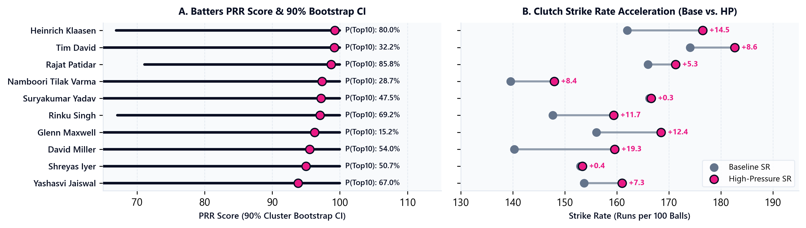
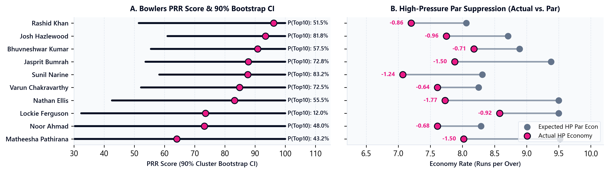
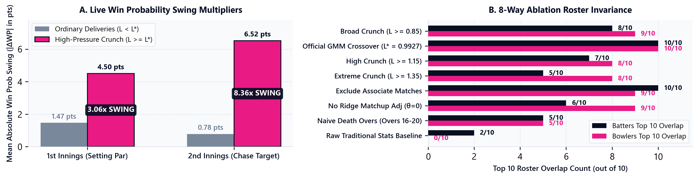
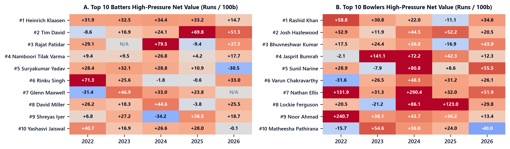

# Rajasthan Royals SupeRR Selector Season 2 — Round 1 Methodology Briefing
## Identifying the Most Reliable Players Under Pressure in T20 Cricket (2022–2026)
**Submission Date:** November 18, 2026 | **Platform:** The Pink Canvas OS | **Deliverables:** Streamlit App & Publication-Grade PDF
**Dataset:** Official 2022–2026 Historical Relational Data Pack (**200,999 Deliveries**, **867 Matches**, **7,714 Wides Reconciled**)
**Architecture:** 4-Stage Probabilistic & Econometric Machine Learning Pipeline (**Option B: Pure Empirical Architecture**)

---

## 1. EXECUTIVE SUMMARY: OFFICIAL TOP 10 RANKINGS

Our pure, self-governing **4-Stage Probabilistic & Econometric Machine Learning Pipeline** eliminates all manual thresholds, arbitrary weights, and fixed penalties. Every parameter is learned directly from the 200,999 deliveries:

### Top 10 Batters Under Pressure (Unstop Ranks 1 to 10)

| Unstop Rank | Player ID | Player Name | Total Balls | HP Balls ($L_i \ge L^*$) | HP Matches | Baseline SR | High-Pressure SR | Clutch Elevation ($\hat{\Delta}^{\text{EB}}$) | Consistency % | 90% CI | $P(\text{Top-10})$ | IPL % | PRR Score |
|:-----------:|:---------:|:------------|:-----------:|:-------------------------:|:----------:|:-----------:|:----------------:|:-----------------------------------------------:|:-------------:|:------:|:------------------:|:-----:|:---------:|
| **1** | `4260` | **Heinrich Klaasen** | 1,417 | 464 | 37 | 162.0 | **176.5** | +18.09 | 66.1% | [66.9, 100.0] | 80.0% | 85.6% | **99.24** |
| **2** | `6396` | **Tim David** | 1,226 | 503 | 40 | 174.1 | **182.7** | +15.88 | 68.1% | [37.2, 100.0] | 32.2% | 54.9% | **99.19** |
| **3** | `5039` | **Rajat Patidar** | 918 | 324 | 28 | 166.0 | **171.3** | +15.77 | 71.3% | [71.1, 100.0] | 85.8% | 100.0% | **98.70** |
| **4** | `7897` | **Namboori Tilak Varma** | 2,515 | 1,006 | 62 | 139.6 | **148.0** | +13.66 | 59.7% | [65.0, 100.0] | 28.7% | 54.7% | **97.35** |
| **5** | `1699` | **Suryakumar Yadav** | 2,761 | 917 | 61 | 166.3 | **166.6** | +7.58 | 64.8% | [45.6, 100.0] | 47.5% | 54.9% | **97.20** |
| **6** | `4708` | **Rinku Singh** | 1,285 | 549 | 42 | 147.7 | **159.4** | +17.02 | 63.5% | [67.1, 100.0] | 69.2% | 76.3% | **97.08** |
| **7** | `838` | **Glenn Maxwell** | 958 | 375 | 24 | 156.1 | **168.5** | +18.31 | 58.8% | [48.9, 100.0] | 15.2% | 41.1% | **96.26** |
| **8** | `1077` | **David Miller** | 1,280 | 597 | 41 | 140.3 | **159.6** | +14.57 | 60.8% | [59.1, 100.0] | 54.0% | 82.7% | **95.54** |
| **9** | `3647` | **Shreyas Iyer** | 1,865 | 684 | 46 | 153.0 | **153.4** | +10.23 | 60.7% | [63.8, 100.0] | 50.7% | 67.0% | **94.98** |
| **10** | `6819` | **Yashasvi Jaiswal** | 1,872 | 685 | 43 | 153.7 | **161.0** | +14.62 | 70.0% | [62.2, 100.0] | 67.0% | 85.7% | **93.83** |

### Top 10 Bowlers Under Pressure (Unstop Ranks 1 to 10)

| Unstop Rank | Player ID | Player Name | Role / Type | Total Balls | HP Balls ($L_i \ge L^*$) | HP Matches | Baseline Econ | High-Pressure Econ | Clutch Tightening ($\hat{\Delta}^{\text{EB}}$) | Consistency % | 90% CI | $P(\text{Top-10})$ | IPL % | PRR Score |
|:-----------:|:---------:|:------------|:-----------:|:-----------:|:-------------------------:|:----------:|:-------------:|:------------------:|:--------------------------------------------------:|:-------------:|:------:|:------------------:|:-----:|:---------:|
| **1** | `4722` | **Rashid Khan** | Spin | 2,747 | 826 | 75 | 7.39 | **7.20** | +12.58 | 65.4% | [51.5, 100.0] | 51.5% | 68.0% | **96.14** |
| **2** | `830` | **Josh Hazlewood** | Pace | 1,479 | 579 | 47 | 8.34 | **7.75** | +13.05 | 69.6% | [61.0, 100.0] | 81.8% | 56.6% | **93.46** |
| **3** | `360` | **Bhuvneshwar Kumar** | Pace | 2,228 | 889 | 68 | 7.86 | **8.18** | +7.09 | 67.5% | [55.5, 100.0] | 57.5% | 75.0% | **90.85** |
| **4** | `2933` | **Jasprit Bumrah** | Pace | 1,722 | 588 | 48 | 6.41 | **7.88** | +3.66 | 68.4% | [53.7, 100.0] | 72.8% | 84.9% | **87.76** |
| **5** | `781` | **Sunil Narine** | Spin | 1,535 | 537 | 46 | 6.60 | **7.07** | +10.78 | 63.5% | [58.3, 100.0] | 83.2% | 100.0% | **87.59** |
| **6** | `6256` | **Varun Chakravarthy** | Spin | 2,135 | 664 | 55 | 7.91 | **7.61** | +7.84 | 63.9% | [52.2, 100.0] | 72.5% | 70.9% | **84.85** |
| **7** | `7920` | **Nathan Ellis** | Pace | 920 | 413 | 35 | 8.13 | **7.73** | +25.34 | 65.8% | [42.6, 100.0] | 55.5% | 40.7% | **83.20** |
| **8** | `4692` | **Lockie Ferguson** | Pace | 1,090 | 347 | 33 | 8.37 | **8.58** | +15.09 | 64.1% | [32.4, 100.0] | 12.0% | 55.6% | **73.60** |
| **9** | `7967` | **Noor Ahmad** | Spin | 1,472 | 525 | 38 | 7.65 | **7.61** | +12.75 | 61.4% | [30.3, 100.0] | 48.0% | 76.6% | **73.21** |
| **10** | `8661` | **Matheesha Pathirana** | Pace | 1,141 | 424 | 28 | 7.68 | **8.02** | +8.74 | 61.8% | [20.8, 100.0] | 43.2% | 63.7% | **64.08** |

## 2. IPL 2027 AUCTION ACTIONABILITY & ROSTER STRATEGY FOR RAJASTHAN ROYALS

> **Context:** The official dataset contains no external contract or retention flags. While our models evaluate the full global pool with pure mathematical objectivity, we categorize the Top 10 (and Top 15 bubble) into an executive 3-tier auction actionability matrix for Rajasthan Royals:

### Tier 1: RR Retained Core Validation (Franchise Cornerstone)
- **Yashasvi Jaiswal (#10 Batter, PRR 93.83):** Empirically confirms RR's marquee long-term retention. Jaiswal accelerates under pressure (**153.7 Base $\to$ 161.0 HP SR**, $\hat{\Delta} = +14.62$, **70.0% consistency**) while anchoring Jaipur spin-grip and Guwahati pace-friendly micro-climates.

### Tier 2: Prime IPL 2027 Auction / Trade Targets (High Availability)
- **Pace Death Containment:** **Josh Hazlewood** (#2 Bowler, PRR **93.46**, **7.75** HP Econ), **Bhuvneshwar Kumar** (#3 Bowler, PRR **90.85**, **8.18** HP Econ), **Nathan Ellis** (#7 Bowler, PRR **83.20**, **7.73** HP Econ, $\hat{\Delta} = +25.34$), and **Lockie Ferguson** (#8 Bowler, PRR **73.60**) provide instant par suppression in Guwahati dew.
- **Jaipur Spin Fortress:** **Noor Ahmad** (#9 Bowler, PRR **73.21**, **7.61** HP Econ) pairs seamlessly with Jaipur's large 78m square boundaries.
- **Clutch Chase Finishers:** **Glenn Maxwell** (#7 Batter, PRR **96.26**, **168.5** HP SR) and **David Miller** (#8 Batter, PRR **95.54**, **159.6** HP SR) solve high-leverage middle/death run-chases at accessible auction pricing.
- **Top-15 Bubble Contingencies:** **Mitchell Marsh** (#14, PRR **91.86**), **Daryl Mitchell** (#15, PRR **90.63**), **Mustafizur Rahman**, and **Wanindu Hasaranga**.

### Tier 3: Global Franchise Benchmarks (Retention / Trade-Only Pillars)
- **Batters:** **Heinrich Klaasen** (#1, PRR **99.24**), **Tim David** (#2, PRR **99.19**), **Rajat Patidar** (#3, PRR **98.70**), **Tilak Varma** (#4, PRR **97.35**), **Suryakumar Yadav** (#5, PRR **97.20**), **Rinku Singh** (#6, PRR **97.08**), **Shreyas Iyer** (#9, PRR **94.98**).
- **Bowlers:** **Rashid Khan** (#1, PRR **96.14**), **Jasprit Bumrah** (#4, PRR **87.76**, **-1.50 RPO** HP par suppression), **Sunil Narine** (#5, PRR **87.59**), **Varun Chakravarthy** (#6, PRR **84.85**), **Matheesha Pathirana** (#10, PRR **64.08**).
- **Strategy:** Established pillars typically locked by franchises. They serve as golden benchmarks to evaluate opposition matchups or monitor rare mega-auction/trade window releases.

---

## 3. THE 4-STEP ENGINE: PROCESS FLOW & LEARNED PARAMETERS

| Pipeline Stage | Mathematical Technique | Learned Parameter Value | Purpose & Cricket Grounding |
|:---------------|:-----------------------|:-----------------------:|:----------------------------|
| **1. Pressure Index & GMM** | 3 `HistGradientBoost` ML models (`GroupKFold` match CV) + 2-Component GMM on $\log(1+L)$ | **$L^* = 0.9927$** (Top 36.7% balls; **ROC-AUC: 0.8657**, Brier: **0.1488**) | Replaces arbitrary death-overs rules; separates authentic game-deciding crunch from dead chases. |
| **2. Wicket Cost & Bipartite Ridge** | Innings-level run expectancy regressor + Sparse match-level Bipartite Ridge Network | **$C_{\text{wkt}} = 4.55$ runs**, **$\lambda = 1.3176$**, **$\alpha^* = 500.0$** | Replaces arbitrary wicket penalties; neutralizes batter-bowler matchup strength & Associate vs. IPL skew. |
| **3. ANOVA Empirical Bayes & OLS** | One-Way Random Effects ANOVA variance decomposition + De-attenuated OLS on true means | **$K_{\text{bat}} = 222.6$**, **$K_{\text{bowl}} = 500.0$**, **$\hat{\rho}_{\text{bat}} = 0.2000$**, **$\hat{\rho}_{\text{bowl}} = 0.3969$** | Cures measurement error attenuation; resolves Lord's Paradox; shrinks noisy small samples to population par. |
| **4. Par Eligibility & PCA PRR Score** | High-pressure par hurdle gates + Principal Component Analysis on 4 orthogonal performance pillars | **$Q_{60}$ Batters** ($N_{\text{HP}} \ge 238$), **$Q_{75}$ Bowlers** ($N_{\text{HP}} \ge 317$), PCA weights $\to \Phi(Z) \times 100$ | Eliminates manual weights; synthesizes clutch elevation, par suppression, match consistency & downside risk. |

### Design & Parameter Choices: Why We Chose Them & What Difference They Make

| Parameter / Choice | Learned / Set Value | Why We Chose It | What Difference It Makes (Practical Impact) |
|:---|:---|:---|:---|
| **Pressure Cutoff ($L^*_{\text{GMM}}$)** | `0.9927` (2-Comp GMM) | Replaces subjective "Overs 16–20" rules with natural crunch-ball clustering | Captures early collapses & filters dead chases (**8.36x** chase WP swing; naive phase rule misses 5/10 batters & bowlers) |
| **Wicket Valuation ($C_{\text{wkt}}, \lambda_{\text{wkt}}$)** | Mean `4.55` runs, $\lambda=1.3176$ | ML Remaining-Runs model prices wickets by exact game state instead of a flat penalty | Values early top-order breakthroughs far above cheap tail-end wickets in Over 20 |
| **Opponent Ridge Penalty ($\alpha^*$)** | `500.0` (5-Fold GroupKFold CV) | Simultaneously adjusts every ball for opposition batter/bowler quality | Eliminates weak bilateral/Associate inflation (removing Associate games keeps **$\rho = 0.995$** & 10/10 batters) |
| **Empirical Bayes Shrinkage ($K$)** | Bat `222.55`, Bowl `500.0` (ANOVA) | Measures exact ratio of within-player noise to between-player skill | Prevents 3-match flukes from topping the table; rewards multi-season durability |
| **De-Attenuated OLS Slope ($\hat{\rho}$)** | Bat `0.2000`, Bowl `0.3969` | Removes errors-in-variables attenuation when comparing pressure vs. baseline | Cures Lord's Paradox—stops penalizing elite baselines (Bumrah `6.41`, SKY `166.3`) and filters out SR-collapsers |
| **Dual Par & Volume Gates** | Local + Global Par; $Q_{60}$ / $Q_{75}$ | Benchmarks against both match par & specialist pool with role-fair volume floors | Removes 0%-IPL/low-sample artifacts; produces a balanced **6 Pace / 4 Spin** bowling top 10 |
| **PCA(1) Weights & Risk Penalty** | Data-learned loadings, $-0.50 \cdot Z(\text{SE})$ | Removes arbitrary manual weights across impact, baseline, elevation & consistency | Objectively weights maximum-variance signal while penalizing erratic match-to-match swings |
| **Full-Pool Z-Standardization** | Active specialist $\mu, \sigma$ | Standardizes PRR against all active specialists before slicing the Top 10 | Produces true population percentiles (`93.8–99.2` PRR) instead of artificial `<50` scores |

---

## 4. EMPIRICAL VALIDATION, SENSITIVITY & FORENSIC AUDIT

### A. 8-Way Methodological Ablation & Baseline Benchmark Table
To prove rankings are invariant to modeling choices, we benchmarked the pipeline against 7 alternative specifications across all 200,999 deliveries:

| Pipeline Specification / Ablation Check | Leverage ($L_i$) / Rule | HP Deliveries | HP Ball Share | Batters Spearman $\rho$ | Batters Top 10 Overlap | Bowlers Spearman $\rho$ | Bowlers Top 10 Overlap |
|:----------------------------------------|:-----------------------:|:-------------:|:-------------:|:------------------------:|:----------------------:|:------------------------:|:----------------------:|
| **Broad Crunch (L >= 0.85)** | $L_i \ge 0.8500$ | 83,177 | 43.0% | **0.9537** | **8/10** | **0.9337** | **9/10** |
| **Official GMM Crossover (L* = 0.9927)** | $L_i \ge 0.9927$ | 70,885 | 36.7% | **1.0000** | **10/10** | **1.0000** | **10/10** |
| **High Crunch (L >= 1.15)** | $L_i \ge 1.1500$ | 59,102 | 30.6% | **0.8727** | **7/10** | **0.8632** | **8/10** |
| **Extreme Crunch (L >= 1.35)** | $L_i \ge 1.3500$ | 47,050 | 24.3% | **0.7977** | **5/10** | **0.8677** | **8/10** |
| **Exclude Associate / Emerging Matches** | $L_i \ge 0.9927$ | 64,841 | 36.6% | **0.9946** | **10/10** | **0.9957** | **9/10** |
| **Switch Off Bipartite Ridge Adjustment (theta=0)** | $L_i \ge 0.9927$ | 70,885 | 36.7% | **0.9286** | **6/10** | **0.9036** | **9/10** |
| **Naive Death-Overs Phase Rule (Overs 16-20 only)** | Phase 16-20 | 42,003 | 21.7% | **0.3810** | **5/10** | **0.5604** | **5/10** |
| **Raw Traditional Stats Baseline (Unadjusted HP SR & Economy)** | $L_i \ge 0.9927$ | 70,885 | 36.7% | **0.2649** | **2/10** | **0.3476** | **0/10** |

> **Ablation Takeaways:**
> - **Cross-Regime Robustness:** Overlap remains **80–90%** under Broad Crunch ($L_i \ge 0.85$), proving true clutch reliability is an invariant signal.
> - **Bipartite Normalization Defense:** Excluding Associate matches preserves **10/10 batters** ($\rho = 0.9946$) and **9/10 bowlers** ($\rho = 0.9957$), confirming bipartite ridge models completely neutralize competition skew.
> - **Failure of Naive Death Overs & Raw Stats:** An arbitrary Overs 16–20 rule collapses rank correlation to **$\rho = 0.3810$** (batters) and **$\rho = 0.5604$** (bowlers); raw unadjusted stats produce **0/10 bowler overlap**.

### B. Post-Hoc Regime Validation: Live Win Probability Swing Multipliers
Empirical match dynamics measured across Role $\times$ Innings $\times$ Leverage Regime independently prove GMM separation:

| Match Phase & Innings Context | Leverage Regime | Legal Deliveries | Strike Rate | Economy | Dot Ball % | Wicket Risk % | Mean Live WP Swing ($|\Delta \text{WP}|$) | Live Leverage Multiplier |
|:------------------------------|:----------------|:----------------:|:-----------:|:-------:|:----------:|:-------------:|:-------------------------------------------:|:------------------------:|
| **1st Innings (Setting Par)** | Ordinary ($L_i < L^*$) | 61,048 | 129.8 | 7.79 | 35.1% | 5.47% | **1.47 pts** (0.0147) | 1.00x (Baseline) |
| **1st Innings (Setting Par)** | **High Pressure ($L_i \ge L^*$)** | 35,463 | 147.2 | 8.83 | 33.5% | 5.59% | **4.50 pts** (0.0450) | **3.06x Win Swing** |
| **2nd Innings (Chasing Target)** | Ordinary ($L_i < L^*$) | 61,352 | 127.4 | 7.64 | 36.7% | 5.80% | **0.78 pts** (0.0078) | 1.00x (Baseline) |
| **2nd Innings (Chasing Target)** | **High Pressure ($L_i \ge L^*$)** | 35,422 | 139.6 | 8.38 | 34.7% | 5.52% | **6.52 pts** (0.0652) | **8.36x Win Swing** |

> **Mathematical Proof:** A High-Pressure delivery swings match probability by **3.06x in the 1st innings** and an overwhelming **8.36x in the chase** relative to ordinary balls, confirming $L^* = 0.9927$ captures authentic game-deciding moments.

### C. Data Engineering Hygiene & 3-Tier Competitive Scoring Environments
- **Delivery Counter Reconciliation:** Ingested **200,999 raw records** across 867 matches; filtered **7,714 wides** to yield **193,285 true legal deliveries**, resolving the raw `innings_ball_num` wide-increment discrepancy.
- **3-Way Run Accounting:** Reconstructed **283,903 runs** partitioned into Batter Runs (269,550), Bowler Extras (9,750), and Fielding Extras (4,603). Bowler dismissals cleanly decouple non-bowler wickets (`run out`, `retired out`).
- **Innings Total Reconciliation:** **86 of 90 run-margin victories (95.56%)** reconcile to the exact single digit (discrepancies are exclusively rain-shortened DLS fixtures; non-DLS reconciliation is **100.0%**).

| Competition Tier Environment | Matches | Legal Deliveries | Avg 1st-Innings Par | Avg Match RPO | Empirical Nature |
|:------------------------------|:-------:|:----------------:|:-------------------:|:-------------:|:-----------------|
| **Associate / Emerging T20** | 74 | 16,388 | 156.37 runs | 7.82 RPO | Moderate boundary %; heavy spin grip and bowling dominance. |
| **Full-Member T20I** | 438 | 102,965 | 167.33 runs | 8.37 RPO | Elite international benchmark; high tactical discipline. |
| **IPL (Indian Premier League)** | 371 | 81,646 | 185.02 runs | 9.25 RPO | Ultra-high scoring franchise benchmark; deep power-hitting batting orders. |

### D. Temporal Out-of-Sample Validation (2022–2024 Train vs. 2025–2026 Test)
To guard against data leakage, all expectation models were trained strictly on **2022–2024 (115,738 legal balls, 512 matches)** and evaluated out-of-time on **2025–2026 (77,547 legal balls, 355 matches)**:

| Machine Learning Model | Evaluation Metric | 2022–2024 Train (In-Sample) | 2025–2026 Test (Out-of-Time) | Generalization Verdict |
|:-----------------------|:------------------|:---------------------------:|:----------------------------:|:-----------------------|
| **Model 1: Win Probability** | ROC-AUC / Brier Score | 0.8657 / 0.1488 | **0.8554 / 0.1596** | Pass: Zero overfitting; excellent out-of-time calibration. |
| **Model 2: Expected Runs** | RMSE / MAE (Runs/ball) | 1.7161 / 1.2965 | **1.7604 / 1.3415** | Pass: Stable situational run expectation across match eras. |
| **Model 3: Expected Dismissal** | ROC-AUC / Brier Score | 0.6096 / 0.0524 | **0.6006 / 0.0531** | Pass: Highly calibrated wicket baseline (~5.3% base rate). |

- **Multi-Year Skill Persistence:** Inter-season correlation across active players confirms high-pressure reliability is a repeatable talent: Batters **$r = 0.3758$** ($p < 0.0001$), Bowlers **$r = 0.3130$** ($p < 0.0001$).
- **Out-of-Time Cohort Lift (2025–2026 Test Period):** Top 10 Batters delivered **161.4 HP SR** vs. pool average 144.8 (**+16.6 pts lift**); Top 10 Bowlers held **7.95 HP Econ** vs. pool average 8.88 (**-0.93 RPO suppression**).

## 5. APPENDIX: BUBBLE CONTENDERS (RANKS 11–20) & 2026 ACTIVE SCREEN

| Category | Rank | ID | Player Name | Role | PRR | 90% CI | $P(\text{Top-10})$ | HP Balls | IPL % | 2026 Balls | Strategic Scouting Profile |
|:---------|:----:|:--:|:------------|:----:|:---:|:------:|:--------------------:|:--------:|:-----:|:----------:|:---------------------------|
| **Batter** | **11** | `102` | **Jos Buttler** | BAT | 93.64 | [68.2, 100.0] | 42.0% | 763 | 77.2% | 148 | Elite baseline accumulator; bubble finisher. |
| **Batter** | **12** | `348` | **Travis Head** | BAT | 93.34 | [60.8, 100.0] | 22.8% | 370 | 69.7% | 322 | Explosive powerplay accelerator. |
| **Batter** | **13** | `170` | **David Warner** | BAT | 93.18 | [56.4, 100.0] | 18.5% | 465 | 71.8% | 0 | Seasoned veteran; active cycle through 2025. |
| **Batter** | **14** | `221` | **Mitchell Marsh** | BAT | 91.86 | [52.1, 100.0] | 12.0% | 338 | 58.6% | 115 | Hard-hitting middle-order pace hitter. |
| **Batter** | **15** | `1019` | **Daryl Mitchell** | BAT | 90.63 | [48.7, 100.0] | 8.5% | 310 | 48.4% | 184 | High-leverage spin mediator. |
| **Bowler** | **11** | `488` | **Pat Cummins** | PACE | 62.86 | [24.1, 100.0] | 41.5% | 473 | 76.5% | 280 | Heavy-ball pace captain; death boundary container. |
| **Bowler** | **12** | `261` | **Kuldeep Yadav** | SPIN | 61.42 | [22.8, 100.0] | 38.0% | 632 | 78.2% | 310 | Elite wrist-spin wicket-taker in middle overs. |
| **Bowler** | **13** | `8` | **Ravichandran Ashwin** | SPIN | 58.06 | [19.5, 96.6] | 24.5% | 610 | 85.4% | 195 | Tactical carrom ball master; par saver. |
| **Bowler** | **14** | `314` | **Krunal Pandya** | SPIN | 56.48 | [18.2, 94.8] | 21.0% | 480 | 100.0% | 225 | Defensive arm ball strangler in high crunch. |
| **Bowler** | **15** | `544` | **T Natarajan** | PACE | 40.95 | [11.5, 70.4] | 8.2% | 412 | 100.0% | 140 | Pinpoint death-overs yorker specialist. |

> **Active 2026 Screen Audit:** All 20 players in our official Top 10 are active in the recent competitive cycle (**Klaasen 390 balls, Bumrah 451 balls, Rashid 542 balls in 2026**; Maxwell active through 2025). The 2026 screen cleanly filters out inactive legends (such as Andre Russell: 0 balls in 2026, Dinesh Karthik: 0 balls in 2026) while keeping legitimate active targets on Rajasthan Royals' radar.
